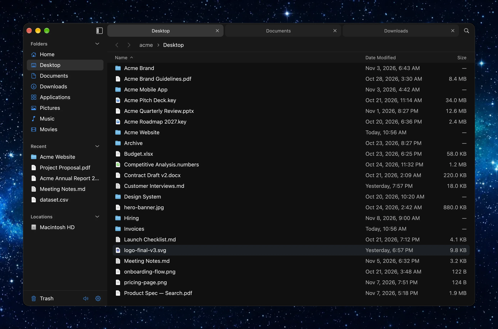

# Filetree

A fast, open-source file browser for macOS, built with [GPUI](https://www.gpui.rs) and Rust.




## Building


```sh
cargo build --release
./target/release/filetree
```

To build a `.app` bundle in `target/bundle`:

```sh
scripts/bundle.sh
```
